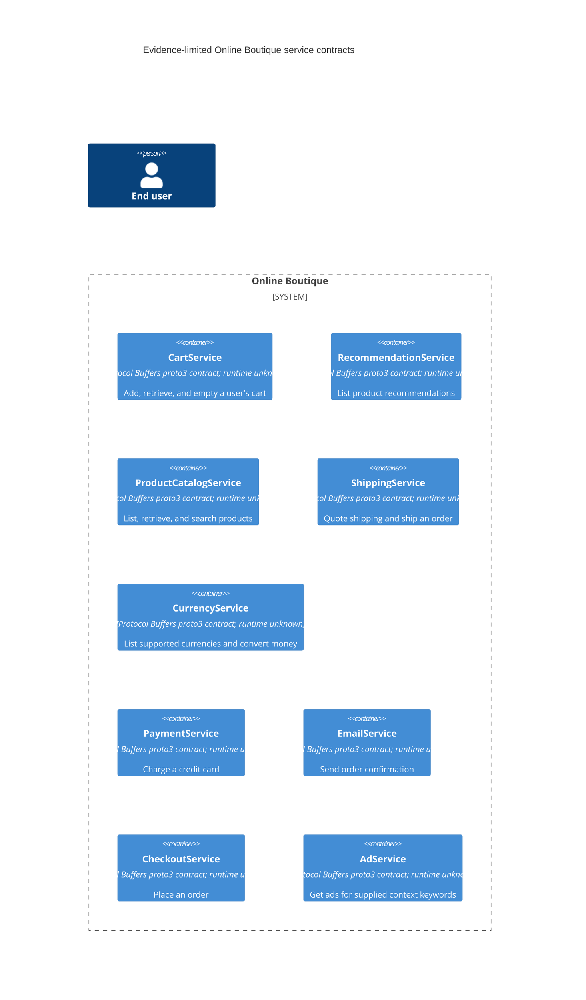

# Online Boutique Architecture Recovery

## Agent

AI assistant using Copilot SDK in VS Code; model: not known.

## Files read

- `prompts/1-recover-architecture.md`
- `system/online-boutique/protos/demo.proto`

## Containers table

The evidence declares service interfaces, but does not establish their deployment as running containers or identify their implementations. The rows below represent only the declared service boundaries; technology is limited to what the file proves.

| Name | Technology/language | Responsibility | Evidence |
|---|---|---|---|
| CartService | Protocol Buffers proto3 service contract; runtime/language unknown | Add, retrieve, and empty a user's cart | `system/online-boutique/protos/demo.proto` — `CartService` RPCs |
| RecommendationService | Protocol Buffers proto3 service contract; runtime/language unknown | List product recommendations | `system/online-boutique/protos/demo.proto` — `RecommendationService.ListRecommendations` |
| ProductCatalogService | Protocol Buffers proto3 service contract; runtime/language unknown | List, retrieve, and search products | `system/online-boutique/protos/demo.proto` — `ProductCatalogService` RPCs |
| ShippingService | Protocol Buffers proto3 service contract; runtime/language unknown | Quote shipping and ship an order | `system/online-boutique/protos/demo.proto` — `ShippingService` RPCs |
| CurrencyService | Protocol Buffers proto3 service contract; runtime/language unknown | List supported currencies and convert money | `system/online-boutique/protos/demo.proto` — `CurrencyService` RPCs |
| PaymentService | Protocol Buffers proto3 service contract; runtime/language unknown | Charge a credit card | `system/online-boutique/protos/demo.proto` — `PaymentService.Charge` |
| EmailService | Protocol Buffers proto3 service contract; runtime/language unknown | Send order confirmation | `system/online-boutique/protos/demo.proto` — `EmailService.SendOrderConfirmation` |
| CheckoutService | Protocol Buffers proto3 service contract; runtime/language unknown | Place an order | `system/online-boutique/protos/demo.proto` — `CheckoutService.PlaceOrder` |
| AdService | Protocol Buffers proto3 service contract; runtime/language unknown | Get ads for supplied context keywords | `system/online-boutique/protos/demo.proto` — `AdService.GetAds` |

## Dependencies table

No runtime caller-to-callee dependencies are evidenced. RPC declarations identify service methods, not which components call them or the transport/protocol used at runtime.

| Caller → callee | Protocol | Evidence |
|---|---|---|
| None established | — | `system/online-boutique/protos/demo.proto` declares RPC services and methods but no caller relationships |

## Mermaid diagram

The end-user person is included to satisfy the requested C4 container-diagram shape; the evidence does not establish any interaction from the end user to these services. No relationships are drawn because no runtime dependencies are shown.

## Gaps

- The file proves service contracts, not deployed container instances, implementations, or languages. `system/online-boutique/` service source files or deployment manifests would establish those.
- No callers, runtime interactions, or transport protocols are shown. Client/service source files or runtime configuration would establish caller-to-callee dependencies and protocols.
- The end user's interaction path is not shown. A frontend/service source file or architecture documentation would establish it.
- No data stores, queues, or external systems are declared in this file. Service source and deployment/configuration files would be needed to determine whether any exist.
