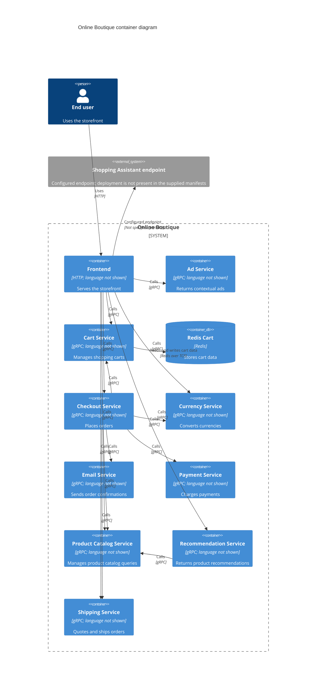

# Online Boutique — C4 Container Architecture (Run B)

## Agent.

GitHub Copilot in VS Code; model: not available to me.

## Files read.

Architecture evidence:

- `system/online-boutique/protos/demo.proto`
- `system/online-boutique/kubernetes-manifests/README.md`
- `system/online-boutique/kubernetes-manifests/kustomization.yaml`
- `system/online-boutique/kubernetes-manifests/adservice.yaml`
- `system/online-boutique/kubernetes-manifests/cartservice.yaml`
- `system/online-boutique/kubernetes-manifests/checkoutservice.yaml`
- `system/online-boutique/kubernetes-manifests/currencyservice.yaml`
- `system/online-boutique/kubernetes-manifests/emailservice.yaml`
- `system/online-boutique/kubernetes-manifests/frontend.yaml`
- `system/online-boutique/kubernetes-manifests/loadgenerator.yaml`
- `system/online-boutique/kubernetes-manifests/paymentservice.yaml`
- `system/online-boutique/kubernetes-manifests/productcatalogservice.yaml`
- `system/online-boutique/kubernetes-manifests/recommendationservice.yaml`
- `system/online-boutique/kubernetes-manifests/shippingservice.yaml`

Task instructions/context:

- `prompts/1-recover-architecture.md`
- `exercise/00-prompt-log.md` (read for task context; not used as architecture evidence)

## Containers table.

| Name | Technology/language | Responsibility | Evidence |
|---|---|---|---|
| Frontend | Kubernetes container; application language not shown; HTTP endpoint | Serves the storefront entry point and is configured to connect to catalog, currency, cart, recommendations, shipping, checkout, ads, and a shopping-assistant endpoint. | `kubernetes-manifests/frontend.yaml` (`frontend-external`, `*_SERVICE_ADDR`); `protos/demo.proto` |
| Ad Service | Kubernetes container; application language not shown; gRPC API | Returns advertisements for supplied context keys. | `kubernetes-manifests/adservice.yaml`; `protos/demo.proto` (`AdService.GetAds`) |
| Cart Service | Kubernetes container; application language not shown; gRPC API | Adds, retrieves, and empties a user's cart. | `kubernetes-manifests/cartservice.yaml`; `protos/demo.proto` (`CartService`) |
| Redis Cart | Redis (`redis:alpine`) | Stores cart data for the Cart Service. | `kubernetes-manifests/cartservice.yaml` (`REDIS_ADDR`, `redis-cart` Deployment) |
| Checkout Service | Kubernetes container; application language not shown; gRPC API | Places an order; configured to call catalog, shipping, payment, email, currency, and cart services. | `kubernetes-manifests/checkoutservice.yaml`; `protos/demo.proto` (`CheckoutService.PlaceOrder`) |
| Currency Service | Kubernetes container; application language not shown; gRPC API | Lists supported currencies and converts monetary amounts. | `kubernetes-manifests/currencyservice.yaml`; `protos/demo.proto` (`CurrencyService`) |
| Email Service | Kubernetes container; application language not shown; gRPC API | Sends order confirmation email requests. | `kubernetes-manifests/emailservice.yaml`; `protos/demo.proto` (`EmailService.SendOrderConfirmation`) |
| Payment Service | Kubernetes container; application language not shown; gRPC API | Charges the supplied credit-card details for an amount. | `kubernetes-manifests/paymentservice.yaml`; `protos/demo.proto` (`PaymentService.Charge`) |
| Product Catalog Service | Kubernetes container; application language not shown; gRPC API | Lists, retrieves, and searches products. | `kubernetes-manifests/productcatalogservice.yaml`; `protos/demo.proto` (`ProductCatalogService`) |
| Recommendation Service | Kubernetes container; application language not shown; gRPC API | Returns product recommendations; configured to call the Product Catalog Service. | `kubernetes-manifests/recommendationservice.yaml`; `protos/demo.proto` (`RecommendationService`) |
| Shipping Service | Kubernetes container; application language not shown; gRPC API | Quotes shipping cost and ships orders. | `kubernetes-manifests/shippingservice.yaml`; `protos/demo.proto` (`ShippingService`) |

The manifests' `kustomization.yaml` includes the ten application services above and excludes `loadgenerator.yaml`; the load generator is therefore not included as a running container in this recovered architecture.

## Dependencies table.

| Caller → callee | Protocol | Evidence |
|---|---|---|
| End user → Frontend | HTTP | `kubernetes-manifests/frontend.yaml` (`frontend-external`, LoadBalancer on port 80; Service port named `http`) |
| Frontend → Product Catalog Service | gRPC | `kubernetes-manifests/frontend.yaml` (`PRODUCT_CATALOG_SERVICE_ADDR`); `protos/demo.proto` (`ProductCatalogService`) |
| Frontend → Currency Service | gRPC | `kubernetes-manifests/frontend.yaml` (`CURRENCY_SERVICE_ADDR`); `protos/demo.proto` (`CurrencyService`) |
| Frontend → Cart Service | gRPC | `kubernetes-manifests/frontend.yaml` (`CART_SERVICE_ADDR`); `protos/demo.proto` (`CartService`) |
| Frontend → Recommendation Service | gRPC | `kubernetes-manifests/frontend.yaml` (`RECOMMENDATION_SERVICE_ADDR`); `protos/demo.proto` (`RecommendationService`) |
| Frontend → Shipping Service | gRPC | `kubernetes-manifests/frontend.yaml` (`SHIPPING_SERVICE_ADDR`); `protos/demo.proto` (`ShippingService`) |
| Frontend → Checkout Service | gRPC | `kubernetes-manifests/frontend.yaml` (`CHECKOUT_SERVICE_ADDR`); `protos/demo.proto` (`CheckoutService`) |
| Frontend → Ad Service | gRPC | `kubernetes-manifests/frontend.yaml` (`AD_SERVICE_ADDR`); `protos/demo.proto` (`AdService`) |
| Frontend → Shopping Assistant endpoint | Not specified (configured at port 80) | `kubernetes-manifests/frontend.yaml` (`SHOPPING_ASSISTANT_SERVICE_ADDR`) |
| Checkout Service → Product Catalog Service | gRPC | `kubernetes-manifests/checkoutservice.yaml` (`PRODUCT_CATALOG_SERVICE_ADDR`); `protos/demo.proto` (`ProductCatalogService`) |
| Checkout Service → Shipping Service | gRPC | `kubernetes-manifests/checkoutservice.yaml` (`SHIPPING_SERVICE_ADDR`); `protos/demo.proto` (`ShippingService`) |
| Checkout Service → Payment Service | gRPC | `kubernetes-manifests/checkoutservice.yaml` (`PAYMENT_SERVICE_ADDR`); `protos/demo.proto` (`PaymentService`) |
| Checkout Service → Email Service | gRPC | `kubernetes-manifests/checkoutservice.yaml` (`EMAIL_SERVICE_ADDR`); `protos/demo.proto` (`EmailService`) |
| Checkout Service → Currency Service | gRPC | `kubernetes-manifests/checkoutservice.yaml` (`CURRENCY_SERVICE_ADDR`); `protos/demo.proto` (`CurrencyService`) |
| Checkout Service → Cart Service | gRPC | `kubernetes-manifests/checkoutservice.yaml` (`CART_SERVICE_ADDR`); `protos/demo.proto` (`CartService`) |
| Recommendation Service → Product Catalog Service | gRPC | `kubernetes-manifests/recommendationservice.yaml` (`PRODUCT_CATALOG_SERVICE_ADDR`); `protos/demo.proto` (`ProductCatalogService`) |
| Cart Service → Redis Cart | Redis over TCP | `kubernetes-manifests/cartservice.yaml` (`REDIS_ADDR`; Redis Service port `6379`, named `tcp-redis`) |

## Mermaid diagram.

## Gaps.

- `loadgenerator.yaml` describes a workload that calls the Frontend, but `kustomization.yaml` comments it out. The supplied evidence does not establish whether another deployment mechanism runs it.
- The Frontend configures `SHOPPING_ASSISTANT_SERVICE_ADDR=shoppingassistantservice:80`, but no Shopping Assistant deployment or service definition is in the supplied manifests. Its protocol and whether it is deployed are unknown.
- Application languages and implementation-level details are not shown by these manifests or the protobuf service definitions. The service source/build files would settle the languages.
- No persistence layer is evidenced for product catalog, orders, payments, email, recommendations, shipping, or ads; no such containers are included.
- The manifests expose a Payment Service API, but do not show whether it calls an external payment processor. Payment Service implementation/configuration would settle that.
